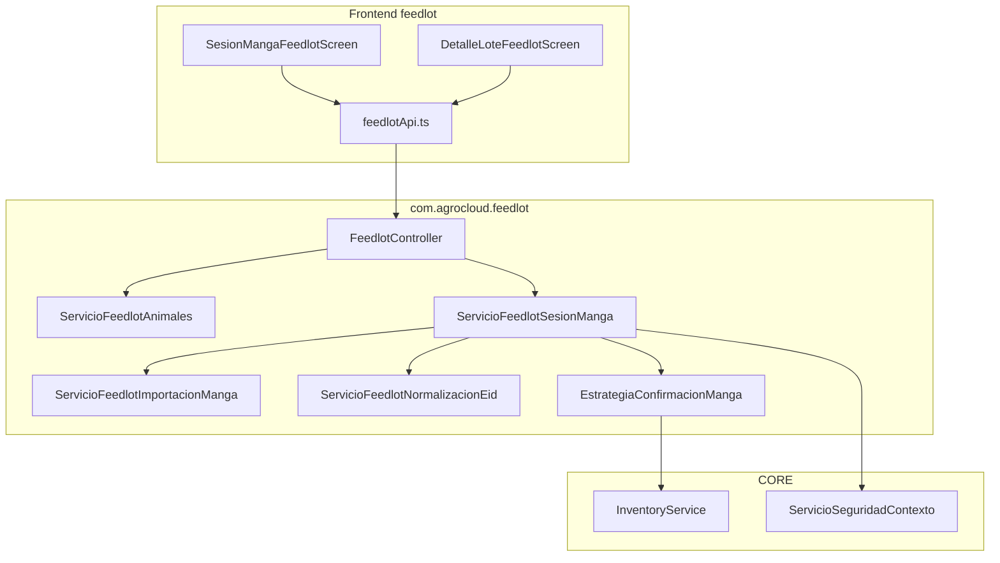
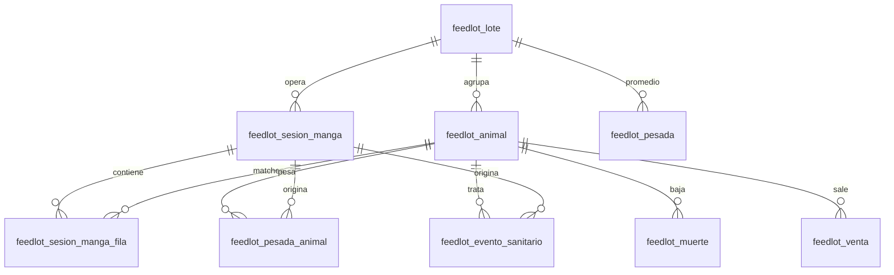
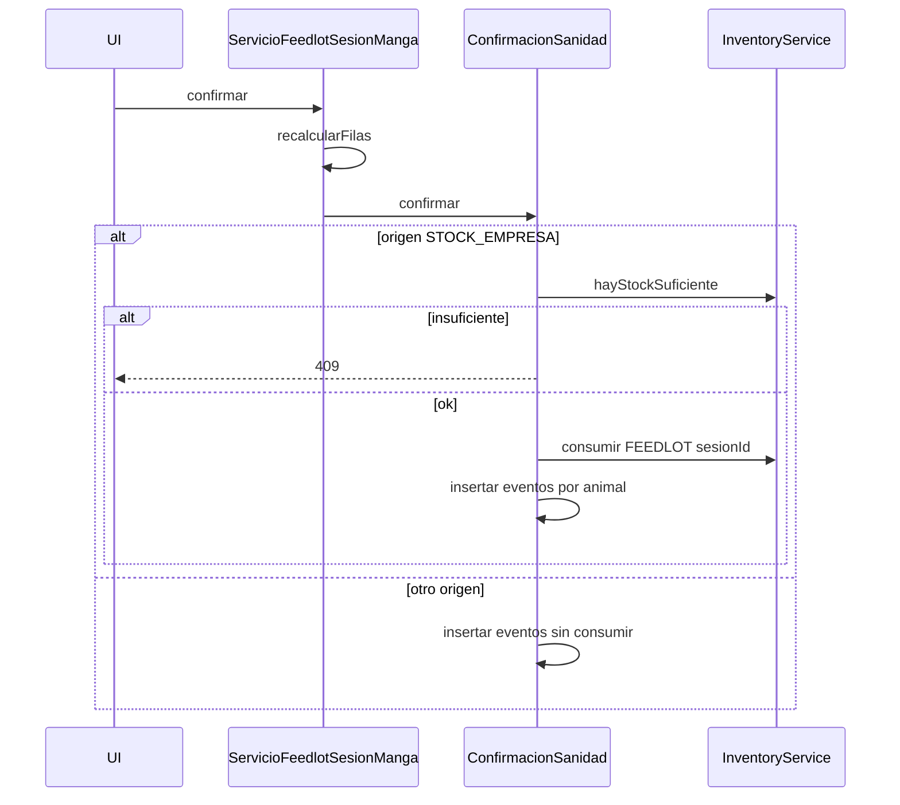

# Diseño técnico — Feedlot v2: padrón individual y sesión de manga

**Versión:** 1.0  
**Fecha:** Septiembre 2026  
**Metodología:** SDD  
**Estado:** Aprobado  
**Fecha aprobación:** 12 de septiembre de 2026  
**SPEC funcional:** `SPEC-FEEDLOT-V2-SESION-MANGA-BASTON.md` (Aprobada, 12 de septiembre de 2026)  
**Complementa:** `DISENO-TECNICO-MODULO-FEEDLOT.md` (v1), `DISENO-TECNICO-MODULO-FEEDLOT-v1.5.md`

---

## 1. Objetivo del documento

Definir la implementación de padrón animal, sesión de manga e importación CSV **antes de escribir código**: esquema, capas backend, contrato REST, frontend y tests mínimos.

No se implementa en esta fase: parsers por marca, hospital/movimientos de corral, Bluetooth, módulo Ganadería, cambios en Lechería.

---

## 2. Decisiones técnicas derivadas de la SPEC

| Decisión SPEC | Implicación técnica |
|---------------|---------------------|
| D01 Feedlot | Tablas `feedlot_*` y endpoints en `FeedlotController` / `/api/feedlot`. Sin módulo nuevo. |
| D02 Lote vs animal | Closeout y `cabezas_actuales` siguen en lote. Eventos individuales referencian `animal_id`. |
| D03 Solo enrolar crea | `EstrategiaConfirmacionEnrolamiento` es la única que hace `save` de `FeedlotAnimal` nuevo. |
| D04 Lote híbrido | No hay constraint `COUNT(activos) = cabezas_actuales`. La UI muestra ambos números. |
| D05 Exceso | `confirmar` recibe `ajustarPlantel`. Si exceso y flag falso → `409`. Si true → `feedlot_ajuste_plantel` + update cabezas (mismo permiso ADMIN/SUPERVISOR que el ajuste v1). |
| D06 Un egreso | `InventoryService.consumir` una vez con `referenciaId = sesion.id`. Persistido en `movimiento_inventario_ref`. |
| D07 Origen ≠ aplicador | Columnas independientes; el servicio solo mira `origen_insumo` para stock. |
| D08 No doble sanidad | Confirmación SANIDAD no llama a `registrarEventoSanitario` de lote. |
| D09 Mapeo | JSON de mapeo en la sesión; sin detector de marca en v2.0. |
| D10 Retiro / faena | Antes de marcar `FAENADO`, consultar último evento del animal con `dias_retiro` vigente. |

**Inventario:** reutilizar `InventoryService` existente (`consumir` / `reponer`), origen `InventoryOrigin.FEEDLOT`. No ampliar CORE.

---

## 3. Arquitectura de capas



`ServicioFeedlotOperaciones` **no** parsea CSV ni confirma sesiones. Solo se reutiliza para crear la pesada/muerte/venta **agregada de lote** cuando la estrategia lo pida (o se extraen métodos privados equivalentes en la estrategia para no mezclar validaciones de UI de lote).

Preferencia: la estrategia llama a métodos de paquete en `ServicioFeedlotOperaciones` (`registrarPesadaInterna`, `registrarMuerteInterna`, `registrarVentaInterna`, `registrarAjusteInterno`) para no duplicar RN-M / RN-V / RN-A. Sanidad de manga **no** usa `registrarEventoSanitario` (evitar egreso por evento).

---

## 4. Migración Flyway

**Archivo:** `agrogestion-backend/src/main/resources/db/migration/V1_177__Feedlot_v2_sesion_manga.sql`

Al implementar, si `V1_177` ya existiera, usar la siguiente versión libre. Hoy el repo llega a `V1_176`.

Motor: InnoDB, `utf8mb4_unicode_ci`, mismo estilo que `V1_153__Modulo_feedlot.sql`.

### 4.1 Diagrama ER



### 4.2 DDL — tablas nuevas

```sql
CREATE TABLE feedlot_animal (
    id                 BIGINT AUTO_INCREMENT PRIMARY KEY,
    empresa_id         BIGINT       NOT NULL,
    lote_id            BIGINT       NOT NULL,
    eid                VARCHAR(15)  NULL,
    caravana_visual    VARCHAR(40)  NULL,
    sexo               VARCHAR(20)  NULL,
    categoria_id       BIGINT       NULL,
    fecha_alta         DATE         NOT NULL,
    estado             VARCHAR(20)  NOT NULL DEFAULT 'ACTIVO',
    fecha_baja         DATE         NULL,
    peso_ingreso_kg    DECIMAL(10,2) NULL,
    observaciones      TEXT         NULL,
    created_at         TIMESTAMP    NOT NULL DEFAULT CURRENT_TIMESTAMP,
    updated_at         TIMESTAMP    NULL DEFAULT NULL ON UPDATE CURRENT_TIMESTAMP,
    CONSTRAINT fk_feedlot_animal_lote FOREIGN KEY (lote_id) REFERENCES feedlot_lote (id) ON DELETE RESTRICT,
    CONSTRAINT fk_feedlot_animal_cat FOREIGN KEY (categoria_id) REFERENCES feedlot_categoria (id) ON DELETE SET NULL,
    CONSTRAINT chk_feedlot_animal_id CHECK (eid IS NOT NULL OR caravana_visual IS NOT NULL),
    UNIQUE KEY uk_feedlot_animal_eid (empresa_id, eid),
    UNIQUE KEY uk_feedlot_animal_visual (empresa_id, caravana_visual),
    INDEX idx_feedlot_animal_lote_estado (lote_id, estado),
    INDEX idx_feedlot_animal_empresa (empresa_id)
) ENGINE=InnoDB DEFAULT CHARSET=utf8mb4 COLLATE=utf8mb4_unicode_ci;
```

**Unicidad con NULL (MySQL):** un índice `UNIQUE (empresa_id, eid)` permite varias filas con `eid` NULL (NULL ≠ NULL). Lo mismo para `caravana_visual`. Es el comportamiento deseado.

Si el motor de tests (H2) no soporta `CHECK`, omitir el CHECK en un `IF` de motor o validar solo en Java (`RN`: al menos EID o caravana).

```sql
CREATE TABLE feedlot_sesion_manga (
    id                      BIGINT AUTO_INCREMENT PRIMARY KEY,
    empresa_id              BIGINT       NOT NULL,
    lote_id                 BIGINT       NOT NULL,
    tipo                    VARCHAR(20)  NOT NULL,
    fecha                   DATE         NOT NULL,
    estado                  VARCHAR(20)  NOT NULL DEFAULT 'BORRADOR',
    nombre_archivo          VARCHAR(255) NULL,
    perfil_mapeo_json       TEXT         NULL,
    delimitador             VARCHAR(8)   NULL,
    filas_ok                INT          NOT NULL DEFAULT 0,
    filas_error             INT          NOT NULL DEFAULT 0,
    detalle_errores         TEXT         NULL,
    usuario_id              BIGINT       NULL,
    movimiento_inventario_ref BIGINT     NULL,
    ajustar_plantel         BOOLEAN      NOT NULL DEFAULT FALSE,
    tipo_evento             VARCHAR(30)  NULL,
    insumo_id               BIGINT       NULL,
    dosis_por_animal        DECIMAL(12,4) NULL,
    unidad_dosis            VARCHAR(20)  NULL,
    cantidad_total          DECIMAL(14,4) NULL,
    dias_retiro             INT          NULL,
    aplicador               VARCHAR(30)  NULL,
    aplicador_nombre        VARCHAR(150) NULL,
    origen_insumo           VARCHAR(30)  NULL,
    descripcion             TEXT         NULL,
    subtipo_baja            VARCHAR(20)  NULL,
    motivo_muerte_id        BIGINT       NULL,
    precio_kg               DECIMAL(12,2) NULL,
    created_at              TIMESTAMP    NOT NULL DEFAULT CURRENT_TIMESTAMP,
    updated_at              TIMESTAMP    NULL DEFAULT NULL ON UPDATE CURRENT_TIMESTAMP,
    CONSTRAINT fk_feedlot_sesion_lote FOREIGN KEY (lote_id) REFERENCES feedlot_lote (id) ON DELETE RESTRICT,
    INDEX idx_feedlot_sesion_lote (lote_id, fecha),
    INDEX idx_feedlot_sesion_empresa_estado (empresa_id, estado)
) ENGINE=InnoDB DEFAULT CHARSET=utf8mb4 COLLATE=utf8mb4_unicode_ci;

CREATE TABLE feedlot_sesion_manga_fila (
    id                  BIGINT AUTO_INCREMENT PRIMARY KEY,
    sesion_id           BIGINT       NOT NULL,
    empresa_id          BIGINT       NOT NULL,
    numero_linea        INT          NOT NULL,
    eid_crudo           VARCHAR(64)  NULL,
    eid_normalizado     VARCHAR(15)  NULL,
    caravana_visual     VARCHAR(40)  NULL,
    peso_kg             DECIMAL(10,2) NULL,
    fecha_hora_lectura  DATETIME     NULL,
    animal_id           BIGINT       NULL,
    resultado           VARCHAR(20)  NOT NULL,
    mensaje             VARCHAR(500) NULL,
    CONSTRAINT fk_feedlot_fila_sesion FOREIGN KEY (sesion_id) REFERENCES feedlot_sesion_manga (id) ON DELETE CASCADE,
    CONSTRAINT fk_feedlot_fila_animal FOREIGN KEY (animal_id) REFERENCES feedlot_animal (id) ON DELETE SET NULL,
    INDEX idx_feedlot_fila_sesion (sesion_id),
    INDEX idx_feedlot_fila_resultado (sesion_id, resultado)
) ENGINE=InnoDB DEFAULT CHARSET=utf8mb4 COLLATE=utf8mb4_unicode_ci;

CREATE TABLE feedlot_pesada_animal (
    id          BIGINT AUTO_INCREMENT PRIMARY KEY,
    empresa_id  BIGINT         NOT NULL,
    animal_id   BIGINT         NOT NULL,
    lote_id     BIGINT         NOT NULL,
    sesion_id   BIGINT         NULL,
    fecha       DATE           NOT NULL,
    peso_kg     DECIMAL(10,2)  NOT NULL,
    created_at  TIMESTAMP      NOT NULL DEFAULT CURRENT_TIMESTAMP,
    CONSTRAINT fk_feedlot_pa_animal FOREIGN KEY (animal_id) REFERENCES feedlot_animal (id) ON DELETE RESTRICT,
    CONSTRAINT fk_feedlot_pa_lote FOREIGN KEY (lote_id) REFERENCES feedlot_lote (id) ON DELETE RESTRICT,
    CONSTRAINT fk_feedlot_pa_sesion FOREIGN KEY (sesion_id) REFERENCES feedlot_sesion_manga (id) ON DELETE SET NULL,
    INDEX idx_feedlot_pa_animal (animal_id, fecha),
    INDEX idx_feedlot_pa_sesion (sesion_id)
) ENGINE=InnoDB DEFAULT CHARSET=utf8mb4 COLLATE=utf8mb4_unicode_ci;
```

### 4.3 ALTER de tablas v1

```sql
ALTER TABLE feedlot_evento_sanitario
    ADD COLUMN animal_id BIGINT NULL,
    ADD COLUMN sesion_id BIGINT NULL,
    ADD COLUMN aplicador VARCHAR(30) NULL,
    ADD COLUMN origen_insumo VARCHAR(30) NULL,
    ADD CONSTRAINT fk_feedlot_san_animal FOREIGN KEY (animal_id) REFERENCES feedlot_animal (id) ON DELETE SET NULL,
    ADD CONSTRAINT fk_feedlot_san_sesion FOREIGN KEY (sesion_id) REFERENCES feedlot_sesion_manga (id) ON DELETE SET NULL;

ALTER TABLE feedlot_muerte
    ADD COLUMN animal_id BIGINT NULL,
    ADD COLUMN sesion_id BIGINT NULL,
    ADD CONSTRAINT fk_feedlot_muerte_animal FOREIGN KEY (animal_id) REFERENCES feedlot_animal (id) ON DELETE SET NULL,
    ADD CONSTRAINT fk_feedlot_muerte_sesion FOREIGN KEY (sesion_id) REFERENCES feedlot_sesion_manga (id) ON DELETE SET NULL;

ALTER TABLE feedlot_venta
    ADD COLUMN animal_id BIGINT NULL,
    ADD COLUMN sesion_id BIGINT NULL,
    ADD CONSTRAINT fk_feedlot_venta_animal FOREIGN KEY (animal_id) REFERENCES feedlot_animal (id) ON DELETE SET NULL,
    ADD CONSTRAINT fk_feedlot_venta_sesion FOREIGN KEY (sesion_id) REFERENCES feedlot_sesion_manga (id) ON DELETE SET NULL;

ALTER TABLE feedlot_pesada
    ADD COLUMN sesion_id BIGINT NULL,
    ADD CONSTRAINT fk_feedlot_pesada_sesion FOREIGN KEY (sesion_id) REFERENCES feedlot_sesion_manga (id) ON DELETE SET NULL;
```

Evento de lote v1: `animal_id` y `sesion_id` nulos. Evento de manga: ambos informados (el de lote agregado de muerte/venta: `animal_id` nulo, `sesion_id` informado, `cabezas` = N).

**Muerte/venta por sesión:** un registro de lote (`animal_id` NULL, `cabezas` = cantidad OK) más, opcionalmente, N filas hijas con `animal_id` y `cabezas = 1` **o** solo el agregado + `animal_id` en cada animal vía estado. Para no inflar KPIs (`sum(muertes.cabezas)`):

**Regla de persistencia (obligatoria):** un solo `feedlot_muerte` o `feedlot_venta` por sesión, con `cabezas = N`, `sesion_id` seteado, `animal_id` NULL. Los animales cambian de `estado` / `fecha_baja`. No crear N filas de muerte/venta.

### 4.4 Enums Java (no DDL)

Paquete `com.agrocloud.feedlot.model.enums`:

| Enum | Valores |
|------|---------|
| `FeedlotEstadoAnimal` | `ACTIVO`, `MUERTO`, `VENDIDO`, `FAENADO`, `DESCARTADO` |
| `FeedlotSexoAnimal` | `MACHO`, `HEMBRA`, `INDEFINIDO` |
| `FeedlotTipoSesionManga` | `ENROLAMIENTO`, `PESADA`, `SANIDAD`, `RECUENTO`, `BAJA` |
| `FeedlotEstadoSesionManga` | `BORRADOR`, `CONFIRMADA`, `ANULADA` |
| `FeedlotResultadoFilaManga` | `OK`, `ERROR`, `ADVERTENCIA` |
| `FeedlotAplicador` | `PERSONAL_ESTABLECIMIENTO`, `VETERINARIO` |
| `FeedlotOrigenInsumo` | `STOCK_EMPRESA`, `PROVEIDO_POR_APLICADOR`, `SIN_INSUMO` |
| `FeedlotSubtipoBaja` | `MUERTE`, `FAENA`, `VENTA_EN_PIE`, `DESCARTE` |

Reutilizar `FeedlotTipoEventoSanitario` existente.

---

## 5. Backend — paquete `com.agrocloud.feedlot`

### 5.1 Archivos nuevos

```
com/agrocloud/feedlot/
├── controller/FeedlotController.java          # ampliar
├── model/entity/
│   ├── FeedlotAnimal.java
│   ├── FeedlotSesionManga.java
│   ├── FeedlotSesionMangaFila.java
│   └── FeedlotPesadaAnimal.java
├── model/enums/                               # enums §4.4
├── model/dto/                                 # ver §5.5
├── repository/
│   ├── FeedlotAnimalRepository.java
│   ├── FeedlotSesionMangaRepository.java
│   ├── FeedlotSesionMangaFilaRepository.java
│   └── FeedlotPesadaAnimalRepository.java
└── service/
    ├── ServicioFeedlotAnimales.java
    ├── ServicioFeedlotNormalizacionEid.java
    ├── ServicioFeedlotImportacionManga.java
    ├── ServicioFeedlotSesionManga.java
    └── manga/
        ├── EstrategiaConfirmacionManga.java   # interfaz
        ├── ConfirmacionEnrolamiento.java
        ├── ConfirmacionPesada.java
        ├── ConfirmacionSanidad.java
        ├── ConfirmacionRecuento.java
        └── ConfirmacionBaja.java
```

### 5.2 `ServicioFeedlotNormalizacionEid`

Método: `Optional<String> normalizar(String crudo)`.

1. `trim`; si vacío → empty.
2. Quitar todo lo que no sea `[0-9A-Fa-f]`.
3. Si solo dígitos: pad left a 15; si length > 15 → empty.
4. Si hay A–F: interpretar como HEX (máx. 16 nibbles FDX-B); convertir a decimal; pad a 15; si overflow → empty.
5. Resultado siempre 15 caracteres `0-9`.

Tests unitarios sin Spring: `" 982 000123456789 "` → `982000123456789`; hex conocido; basura → empty.

### 5.3 `ServicioFeedlotAnimales`

| Método | Lógica |
|--------|--------|
| `listarPorLote(loteId)` | Empresa + lote; orden `caravana_visual`, `eid` |
| `obtener(id)` | Ficha: animal + pesadas + sanitarios + retiro vigente |
| `retiroVigente(animalId, fecha)` | `true` si existe evento con `dias_retiro` y `fechaEvento + dias >= fecha` |

Unicidad: al crear, `existsByEmpresaIdAndEid` / `existsByEmpresaIdAndCaravanaVisual` (ignorar null).

### 5.4 `ServicioFeedlotImportacionManga`

Entrada: `MultipartFile` o texto, `delimitador` (`AUTO` \| `,` \| `;` \| `\t`), `FeedlotMapeoColumnas` (`indiceEid`, `indiceCaravanaVisual`, `indicePeso`, `indiceFechaHora`; índices 0-based, null = no usar).

1. Leer bytes; UTF-8; si el preview tiene `�` masivo, reintentar `windows-1252`.
2. Primera línea: si ninguna celda normaliza a EID y hay texto no numérico → encabezado (saltar).
3. Por línea: armar `FeedlotSesionMangaFila` (aún sin resultado de dominio).
4. Reemplazar filas previas de la sesión (`deleteBySesionId` + insert).

No confirma efectos. El preview de dominio lo hace `ServicioFeedlotSesionManga.recalcularFilas`.

**`perfil_mapeo_json` ejemplo:**

```json
{"indiceEid":0,"indiceCaravanaVisual":1,"indicePeso":2,"indiceFechaHora":null,"delimitador":";"}
```

### 5.5 `ServicioFeedlotSesionManga`

| Método | Estado origen | Efecto |
|--------|---------------|--------|
| `crearBorrador(solicitud)` | — | Valida lote `ACTIVO`, tipo, fecha, cabecera según tipo. Estado `BORRADOR`. |
| `actualizarCabecera(id, solicitud)` | `BORRADOR` | Sanidad/baja/ajuste. |
| `cargarArchivo(id, archivo, mapeo)` | `BORRADOR` | Importación + `recalcularFilas`. |
| `obtener(id)` | cualquiera | Cabecera + filas + `resumenRecuento` si tipo `RECUENTO`. |
| `listarPorLote(loteId)` | — | Historial sin filas. |
| `confirmar(id, confirmarSolicitud)` | `BORRADOR` | Recalcula; exige al menos 1 `OK` salvo recuento (recuento puede confirmarse con 0 presentes). Transacción. Estrategia. `CONFIRMADA`. |
| `anular(id)` | `CONFIRMADA` | Estrategia.revertir. `ANULADA`. |

`recalcularFilas` (todas las estrategias de **evaluación**, no de persistencia de dominio):

- Normalizar EID.
- Match: 1) `eid_normalizado`; 2) `caravana_visual`.
- Conflicto EID vs visual (SPEC §7.2) → `ERROR`.
- Tipo ≠ ENROLAMIENTO y sin animal o no `ACTIVO` del lote → `ERROR`.
- ENROLAMIENTO: ver RN-MG-E02–E05 (idempotente mismo lote = `OK` + `animal_id`; otro lote = `ERROR`).
- PESADA: peso ≤ 0 → `ERROR`.

Defaults sanidad al crear borrador si no vienen: aplicador `PERSONAL_ESTABLECIMIENTO` → `STOCK_EMPRESA`; `VETERINARIO` → `PROVEIDO_POR_APLICADOR`.

`cantidad_total` al confirmar SANIDAD + `STOCK_EMPRESA`: si null, `dosis_por_animal * filas OK`.

### 5.6 Estrategias de confirmación

Interfaz:

```java
public interface EstrategiaConfirmacionManga {
    FeedlotTipoSesionManga tipo();
    void confirmar(FeedlotSesionManga sesion, List<FeedlotSesionMangaFila> filasOk);
    void revertir(FeedlotSesionManga sesion);
}
```

Registro: `Map<FeedlotTipoSesionManga, EstrategiaConfirmacionManga>` inyectado en `ServicioFeedlotSesionManga`.

#### Enrolamiento

- Crear animal por fila OK sin `animal_id`.
- Si `activosResultantes > lote.cabezasActuales` y `!ajustarPlantel` → `IllegalStateException` / 409.
- Si ajuste: permiso ADMIN/SUPERVISOR; `registrarAjusteInterno`; `cabezasActuales = activos`.
- Revertir: borrar animales creados por esa sesión (`fecha_alta` + no usados en otras sesiones). Si un animal ya tiene pesada/sanidad posterior → no anular (409 «sesión con efectos posteriores»). Simplificación v2.0: anular enrolamiento solo si ningún animal de la sesión tiene otros eventos ni es referenciado por otra sesión confirmada.

#### Pesada

- Insertar `feedlot_pesada_animal` por fila OK.
- Insertar `feedlot_pesada` lote: promedio, `cabezas_muestreadas = N`, `sesion_id`.
- Revertir: borrar pesadas animal y pesada de lote de esa `sesion_id`.

#### Sanidad

- Validar cabecera RN-MG-S01–S04.
- Si `STOCK_EMPRESA`: `hayStockSuficiente`; si no → 409; si sí → `consumir(..., sesion.getId())`; guardar id lógico en `movimiento_inventario_ref` (el `referenciaId` del movimiento **es** `sesion.id`; no hace falta otro id si `consumir` no devuelve PK — persistir `sesion.id` en `movimiento_inventario_ref` como la referencia usada).
- Insertar N `feedlot_evento_sanitario` (sin cantidad, `animal_id` + `sesion_id`).
- Revertir: `reponer` si hubo stock; borrar eventos con `sesion_id`.

#### Recuento

- No muta padrón ni stock. Solo persiste filas (ya en borrador) y pasa a `CONFIRMADA`.
- `resumenRecuento` se calcula al vuelo: presentes, faltantes (`ACTIVO` del lote no en filas OK), intrusos (match otro lote o desconocido).
- Revertir: solo estado `ANULADA`.

#### Baja

- Por cada fila OK: set estado + `fecha_baja`.
- FAENA + retiro vigente: esa fila debió ser `ERROR` en recálculo; no incluir.
- Un `feedlot_muerte` o `feedlot_venta` agregado (`cabezas = N`, `sesion_id`).
- `cabezasActuales -= N`; si 0, cierre lote (misma lógica RN-L07).
- Revertir: restaurar animales a `ACTIVO`, borrar muerte/venta de la sesión, sumar cabezas, reabrir lote si se cerró solo por esta sesión (si `fecha_cierre` = fecha sesión y no hay otras ventas/muertes posteriores).

### 5.7 DTOs

Nombres en castellano.

| DTO | Campos principales |
|-----|-------------------|
| `FeedlotAnimalRespuesta` | id, loteId, eid, caravanaVisual, sexo, estado, fechaAlta, fechaBaja, pesoIngresoKg, retiroVigente |
| `FeedlotAnimalDetalleRespuesta` | anterior + pesadas[], eventosSanitarios[] |
| `FeedlotSesionMangaSolicitud` | loteId, tipo, fecha, cabecera sanidad/baja, ajustarPlantel |
| `FeedlotMapeoColumnas` | indiceEid, indiceCaravanaVisual, indicePeso, indiceFechaHora, delimitador |
| `FeedlotSesionMangaFilaRespuesta` | numeroLinea, eidCrudo, eidNormalizado, caravanaVisual, pesoKg, animalId, resultado, mensaje |
| `FeedlotSesionMangaRespuesta` | cabecera + filas + filasOk + filasError + resumenRecuento |
| `FeedlotResumenRecuento` | presentes, faltantes (lista id/eid/visual), intrusos (lista), cabezasSinEnrolar |
| `FeedlotConfirmarSesionSolicitud` | ajustarPlantel (override), cantidadTotal (override sanidad) |

`cabezasSinEnrolar` = `max(0, cabezasActuales - count(ACTIVO enrolados))` al momento de la consulta.

### 5.8 API REST

Base: `/api/feedlot`. Clase: `@RequiresModule("FEEDLOT")`. Escrituras: `permission = "write"`.

| Método | Ruta | Permiso extra | Servicio |
|--------|------|---------------|----------|
| GET | `/lotes/{id}/animales` | read | `listarPorLote` |
| GET | `/animales/{id}` | read | `obtener` |
| POST | `/sesiones-manga` | write | `crearBorrador` |
| PUT | `/sesiones-manga/{id}` | write | `actualizarCabecera` |
| POST | `/sesiones-manga/{id}/archivo` | write | `cargarArchivo` (`multipart/form-data`: `archivo`, `mapeo` JSON o params) |
| GET | `/sesiones-manga/{id}` | read | `obtener` |
| GET | `/lotes/{id}/sesiones-manga` | read | `listarPorLote` |
| POST | `/sesiones-manga/{id}/confirmar` | write; si ajuste, ADMIN/SUPERVISOR | `confirmar` |
| POST | `/sesiones-manga/{id}/anular` | write | `anular` |

Códigos: 400 validación; 404 lote/sesión/animal; 409 lote cerrado, stock, exceso sin ajuste, anulación inválida, EID conflicto de negocio; 402 sin módulo (interceptor existente).

Campaña cerrada: interceptor CORE existente (mismas escrituras).

### 5.9 Integración inventario (secuencia)



---

## 6. Frontend — módulo `feedlot`

Identificadores y textos en castellano.

### 6.1 Archivos

| Archivo | Cambio |
|---------|--------|
| [`menu.ts`](agrogestion-frontend/src/modules/feedlot/menu.ts) | Ítem `sesion-manga`, nombre «Sesión de manga», ruta `/feedlot/manga` |
| [`routes.tsx`](agrogestion-frontend/src/modules/feedlot/routes.tsx) | `/feedlot/manga`, `/feedlot/manga/:id`, `/feedlot/lotes/:id/animales/:animalId` |
| [`feedlotApi.ts`](agrogestion-frontend/src/modules/feedlot/services/feedlotApi.ts) | Funciones listadas en §5.8 |
| [`types.ts`](agrogestion-frontend/src/modules/feedlot/types.ts) | Tipos de sesión, animal, mapeo, recuento |
| `pages/SesionMangaFeedlotScreen.tsx` | Wizard alta |
| `pages/DetalleSesionMangaFeedlotScreen.tsx` | Preview / confirmar / anular |
| `pages/DetalleAnimalFeedlotScreen.tsx` | Ficha |
| [`DetalleLoteFeedlotScreen.tsx`](agrogestion-frontend/src/modules/feedlot/pages/DetalleLoteFeedlotScreen.tsx) | Pestaña «Animales» + enlace a manga; ayuda en pestaña Sanidad |

### 6.2 Wizard (4 pasos)

1. **Tipo y lote:** select tipo, lote activo, fecha.
2. **Cabecera:** según tipo (sanidad: aplicador, origen, insumo, dosis, retiro; baja: subtipo, motivo; enrolamiento: checkbox ajuste plantel).
3. **Archivo:** upload CSV, delimitador, mapeo de columnas (select por encabezado detectado).
4. **Preview:** tabla de filas (color OK/ERROR/ADVERTENCIA), conteos, resumen recuento. Botón Confirmar. Si exceso enrolados, exigir checkbox ajuste (deshabilitado sin rol).

Estados: no confirmar si `filasError > 0` y el usuario no destildó «ignorar errores» — **decisión UI:** se confirman solo filas `OK`; los `ERROR` quedan en el log. No hace falta destildar. Recuento siempre confirmable.

### 6.3 Detalle de lote

Nueva pestaña **Animales**: tabla eid, caravana, estado, retiro; link a ficha. Chip «lote híbrido» si `cabezasActuales > activosEnrolados`.

Sanidad v1: `Alert` — «Para vacunar por caravana electrónica usá Sesión de manga. Este formulario descuenta stock del lote completo.»

### 6.4 Cliente API

Mismos helpers `mensajeError` y header de campaña que el resto de `feedlotApi.ts`.

```typescript
export async function crearSesionManga(cuerpo: FeedlotSesionMangaSolicitud): Promise<FeedlotSesionManga>
export async function subirArchivoSesionManga(id: number, archivo: File, mapeo: FeedlotMapeoColumnas): Promise<FeedlotSesionManga>
export async function confirmarSesionManga(id: number, cuerpo?: FeedlotConfirmarSesionSolicitud): Promise<FeedlotSesionManga>
```

`subirArchivo`: `FormData` con `archivo` + `mapeo` (JSON string).

---

## 7. Tests mínimos (backend)

Ubicación: `agrogestion-backend/src/test/java/com/agrocloud/feedlot/`

| Clase | Escenarios |
|-------|------------|
| `ServicioFeedlotNormalizacionEidTest` | Decimal con espacios; pad; HEX válido; inválido vacío |
| `ServicioFeedlotSesionMangaEnrolamientoTest` | Crea animales; idempotente mismo lote; rechaza otro lote; 409 exceso sin ajuste; ajuste incrementa cabezas |
| `ServicioFeedlotSesionMangaPesadaSanidadTest` | Pesada no crea animal; sanidad stock un `consumir`; vet no consume; stock insuficiente no confirma |
| `ServicioFeedlotSesionMangaRecuentoBajaTest` | Recuento no muta; faena con retiro marca ERROR y confirma el resto; anular sanidad llama `reponer` |
| `FeedlotSesionMangaControllerIntegracionTest` | POST sin módulo 402; confirmar borrador OK 200 |

Mocks: `InventoryService` en unitarios de sanidad. Integración: perfil test existente del módulo feedlot.

QA manual (browser, `admin@agrocloud.com`, empresa demo):

- Enrolar CSV genérico (columna EID).
- Pesada del mismo archivo + columna peso.
- Vacuna stock vs vacuna vet (verificar stock en Insumos).
- Recuento faltantes.
- Faena de animal recién vacunado con retiro 15 días → fila error.

---

## 8. Criterios de implementación (definición de hecho)

- Migración `V1_177` (o siguiente libre) aplicada en entorno de test.
- Endpoints §5.8 responden con `@RequiresModule("FEEDLOT")`.
- Wizard usable de punta a punta para los cinco tipos.
- Tests de §7 en verde.
- Sin parsers de marca. Sin hospital. Sin código en `lecheria`.

---

## 9. Fuera de alcance de este diseño

- Perfiles Allflex / Tru-Test / Gallagher / Datamars.
- `feedlot_movimiento_corral` / hospital.
- Honorarios veterinario como `Egreso` CORE.
- App offline / Bluetooth.
- Sincronización SENASA.

---

## 10. Aprobación del diseño

**Aprobado** el 12 de septiembre de 2026. Implementación según las secciones 4–7.
